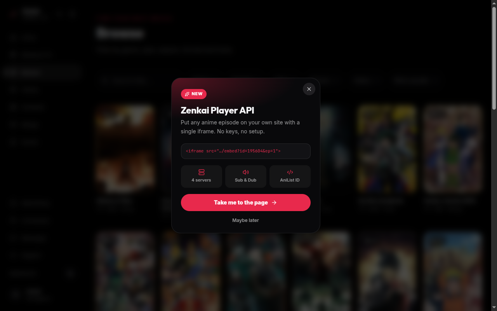
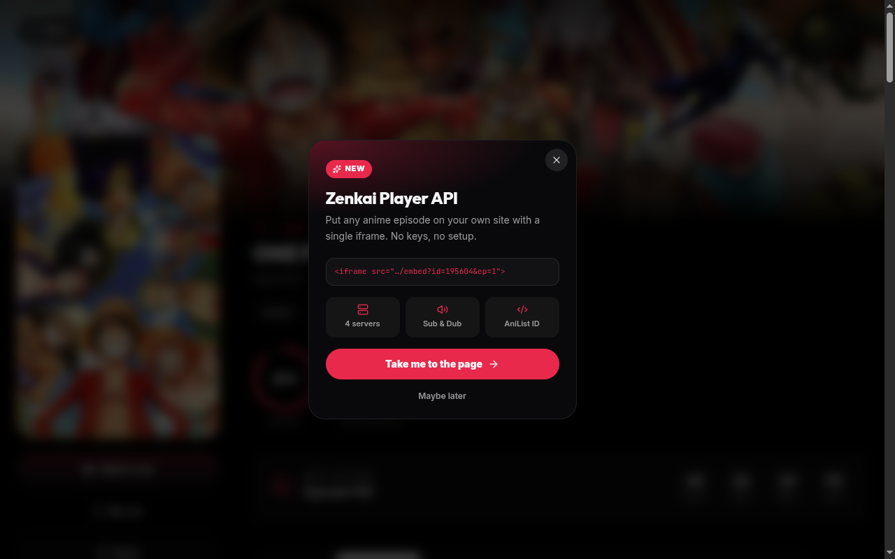
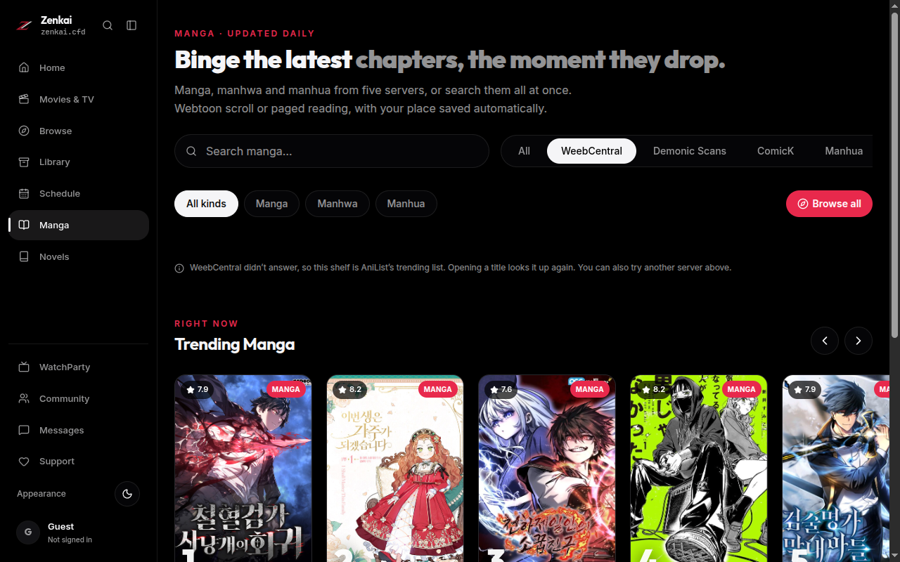
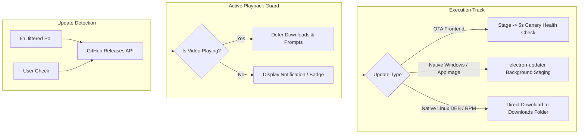
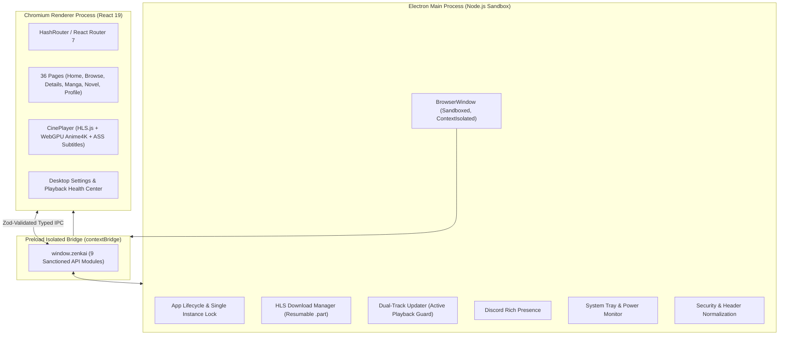

<p align="center">
  
</p>

<h1 align="center">Zenkai Desktop</h1>

<p align="center">
  <strong>The premier, standalone desktop application for Zenkai</strong><br />
  Watch anime online in HD with English Sub &amp; Dub, stream movies, and read manga &amp; novels in one sleek native application.
</p>

<p align="center">
  <a href="https://github.com/johan-droid/Zenkai-Desktop-/actions/workflows/ci.yml"></a>
  <a href="https://github.com/johan-droid/Zenkai-Desktop-/actions/workflows/release.yml"></a>
  <a href="package.json"></a>
  <a href="electron-builder.yml"></a>
  <a href="tsconfig.json"></a>
  <a href="package.json"></a>
</p>

---

## Table of Contents

- [About Zenkai Desktop](#about-zenkai-desktop)
- [Key Features](#key-features)
- [Application Showcase & Real Screenshots](#application-showcase--real-screenshots)
- [Installation Guide](#installation-guide)
  - [Linux (AppImage, DEB, RPM)](#linux)
  - [Windows (NSIS Setup & Portable Zip)](#windows)
  - [macOS (DMG & Zip)](#macos)
  - [Building From Source](#building-from-source)
- [Release History & Downloads](#release-history--downloads)
- [Update Management Engine & Active Playback Guard](#update-management-engine--active-playback-guard)
- [System Requirements](#system-requirements)
- [Development Setup & Quality Verification](#development-setup--quality-verification)
- [Application Architecture](#application-architecture)
- [Troubleshooting & FAQ](#troubleshooting--faq)
- [Security & Privacy Boundaries](#security--privacy-boundaries)
- [Contributing](#contributing)
- [License & Acknowledgements](#license--acknowledgements)

---

## About Zenkai Desktop

**Zenkai Desktop** bridges the gap between lightweight web streaming and high-fidelity desktop software. Rather than acting as a superficial web wrapper, the application runs a verified offline-first build of the authentic [Zenkai Web](https://github.com/nyyrox2/Zenkai) React 19 application locally inside an isolated Chromium sandbox. Native capabilities are managed by an Electron main process communicating through a strictly typed 9-module preload bridge.

```
┌───────────────────────────────────────────────────────────────┐
│                    Zenkai Desktop Window                      │
│                                                               │
│  ┌─────────────────────────┐   ┌───────────────────────────┐  │
│  │   DesktopSidebar        │   │  React 19 Renderer        │  │
│  │   - Zenkai Trademark    │   │  - Discover Hero Carousel │  │
│  │   - Nav Icons           │   │  - CinePlayer Video Core  │  │
│  │   - Quick Search        │   │  - Manga / Novel Readers  │  │
│  │   - Status Indicators   │   │  - Offline Catalog Cache  │  │
│  └─────────────────────────┘   └───────────────────────────┘  │
│                                 │ (Typed Zod-Validated IPC)   │
│                                 ▼                             │
│  ┌─────────────────────────────────────────────────────────┐  │
│  │       Hardened Preload Bridge (window.zenkai)           │  │
│  └─────────────────────────────────────────────────────────┘  │
│                                 │                             │
│                                 ▼                             │
│  ┌─────────────────────────────────────────────────────────┐  │
│  │   Main Process Engine (Node.js Sandbox)                 │  │
│  │   - HLS Concurrent Downloader with AES-128 Decryption   │  │
│  │   - Active Playback Guard & Dual-Track OTA Updater     │  │
│  │   - Discord Rich Presence & OS Native Tray Integration  │  │
│  └─────────────────────────────────────────────────────────┘  │
└───────────────────────────────────────────────────────────────┘
```

### Native Desktop vs. Online Services Boundary

| Capability | Execution Model | Architectural Implementation |
|---|---|---|
| **HLS Stream Downloader** | **Desktop Native** | Concurrent segment streaming with resumable `.part` file buffering, in-memory AES-128 decryption, and automatic `.srt` subtitle embedding. |
| **Active Playback Guard** | **Desktop Native** | Monitors media playback state globally; automatically defers background downloads, update prompts, and restarts while video is playing. |
| **Dual-Track Updater** | **Desktop Native** | Independent OTA frontend updates with 5-second canary health checks & instant rollback + native runtime auto-updater via GitHub Releases. |
| **Discord Rich Presence** | **Desktop Native** | IPC-driven live activity status broadcasting show title, episode number, elapsed time, and posters directly to Discord. |
| **System Tray & Hotkeys** | **Desktop Native** | OS tray integration with quick actions (Play/Pause, Show/Hide, Quit) and window state persistence. |
| **Anime Catalog Discovery** | **Online API + Scraped Fallback** | AniList GraphQL query engine with resilient pre-scraped home and catalog datasets for 100% offline and rate-limit resilience. |
| **Stream Resolvers** | **Online API** | Deterministic multi-server resolver (MegaPlay, Vidstream, FlixCloud, AnimeSalt, ACDN) with canonical ID mapping. |
| **Cloud Library Sync** | **Online API** | Supabase authentication, watch party synchronization, and AniList OAuth2 progress tracking. |

---

## Key Features

### 🌟 Discovery & Catalog Browsing
- **AniList GraphQL Engine**: Instant access to seasonal populars, trending titles, genre filtering, studio information, and community ratings.
- **Scraped Fallback Architecture**: Bundled authentic fallback catalog ensuring discovery shelves, hero carousel, and latest episodes never display 403 or server error states.
- **Search Modal (`Ctrl+K`)**: Rapid debounced search across thousands of titles with keyboard navigation.
- **Spotlight Cards & Carousels**: Featured anime spotlights with hover-responsive 3D perspective tilt.

### 🎬 CinePlayer Playback Engine
- **Hardware-Accelerated HLS**: Adaptive bitrate video streaming (1080p, 720p, 480p, 360p) with seamless server failover.
- **Anime4K WebGPU Neural Upscaler**: Local GPU shader pipeline upscaling anime footage to crisp 4K fidelity in real time.
- **OctoSub ASS/SSA Subtitle Parser**: WebGL-rendered styled subtitles with karaoke typesetting, font embedding, and positioning, alongside standard SRT and WebVTT tracks.
- **Multi-Track Audio**: Switch between Japanese Original (Sub) and English/Regional Dubs directly in the player.
- **Spatial & TV Mode Navigation**: Full D-Pad remote and keyboard shortcut navigation (`useSpatialNav`) for home-theater setups.
- **Picture-in-Picture (PiP)**: Native always-on-top floating player window.

### ⚡ Resilient Offline Download Manager
- **Concurrent Queue**: Multi-connection downloader supporting up to 3 active concurrent jobs with auto-throttling.
- **Resumable Segments (`.part`)**: Network interruptions, sleep modes, or app restarts resume from the exact last verified segment.
- **In-Memory AES-128 Processing**: Decryption keys and vectors are processed strictly in RAM and never written to disk in unencrypted intermediate files.
- **Automated Subtitle Pairing**: Fetches and embeds matching `.srt` or `.ass` subtitle files beside downloaded media (`<title>.ep<num>.<lang>.srt`).
- **Taskbar Progress Indicator**: Synchronizes real-time download completion percentage with the OS taskbar badge.

### 📖 Integrated Manga & Novel Readers
- **Manga Reader**: Continuous vertical webtoon scroll, single/double page reading, chapter caching, and reading progress synchronization.
- **Novel Reader**: Clean typography reflow engine with customizable font families, sizes, night modes, and chapter indexes.

### 📺 Movies, TV & Watch Parties
- **Movies & TV Section**: TMDB-backed metadata, season indexes, and embed servers for western films and series.
- **Watch Parties & Calls**: WebRTC voice rooms and Supabase real-time watch sessions with synchronized playback.

### ⚙️ Native Desktop Settings & Playback Health Center
- **Release Channel Switching**: Toggle between `Stable` (verified releases with canary rollouts) and `Beta` (bleeding-edge server adapters).
- **Playback Health Center**: Real-time diagnostic latency probes to AniList GraphQL API, GitHub Releases, and Cloud CDN.
- **Storage Management**: Visual download directory display with one-click native file-manager folder opener.

---

## Application Showcase & Real Screenshots

All screenshots below are authentic captures from the actual running **Zenkai Desktop** application window (1280x800 resolution) with live media and catalogue content populated:

### 1. Home / Discover Screen
Featuring the persistent collapsible `DesktopSidebar` with the official Zenkai trademark logo, spotlight hero carousel, trending anime rows, continue-watching tracker, and latest released episodes.

<p align="center">
  
</p>

---

### 2. Anime Catalog & Filtering Grid
Comprehensive catalogue exploration powered by AniList GraphQL with genre filtering, release year, season, media format, and sort order controls.

<p align="center">
  
</p>

---

### 3. Anime Details & Episode Selector
Full show overview for *One Piece* (ID: 21), including banner artwork, synopsis, rankings, character carousels, related franchises, recommendations, and episode list.

<p align="center">
  
</p>

---

### 4. Desktop Settings & Playback Health Center
Native desktop configuration hub featuring release channel selection (`Stable` vs `Beta`), manual update check, active playback protection status, download storage path viewer, and live API latency telemetry.

<p align="center">
  
</p>

---

### 5. Manga Reader & Catalog
Integrated manga reader with vertical webtoon scrolling, single-page reading mode, chapter caching, and reading progress synchronization.

<p align="center">
  
</p>

---

### 6. Movies & TV Series
TMDB-backed catalog integration for western cinema and television series with multi-source server resolution and season browsing.

<p align="center">
  
</p>

---

## Installation Guide

### Linux

#### Option A: AppImage (Recommended for all distributions)
The AppImage is fully self-contained and supports seamless in-place delta updates:
```bash
# 1. Make executable
chmod +x Zenkai-Desktop-*-Linux-x64.AppImage

# 2. Run
./Zenkai-Desktop-*-Linux-x64.AppImage
```

#### Option B: Debian / Ubuntu Package (`.deb`)
```bash
sudo dpkg -i Zenkai-Desktop-*-Linux-x64.deb
sudo apt-get install -f  # Resolve any missing desktop dependencies
```

#### Option C: Fedora / RHEL Package (`.rpm`)
```bash
sudo rpm -Uvh Zenkai-Desktop-*-Linux-x64.rpm
```

---

### Windows

#### Option A: Interactive NSIS Setup (`.exe`)
1. Download `Zenkai-Desktop-*-Windows-x64-Setup.exe`.
2. Run the installer and select your destination directory.
3. Choose whether to create desktop and Start Menu shortcuts.
4. Launch **Zenkai Desktop** from the Start Menu.

#### Option B: Standalone Portable (`.zip`)
1. Download `Zenkai-Desktop-*-Windows-x64-Portable.zip`.
2. Extract the archive to any desired folder.
3. Double-click `Zenkai.exe` to run immediately with zero system modifications.

---

### macOS

1. Download `Zenkai-Desktop-*-macOS-universal.dmg`.
2. Open the disk image and drag **Zenkai** into your `/Applications` folder.
3. Launch Zenkai from Launchpad or Spotlight.

---

### Building From Source

You can compile and package the application directly from source:

```bash
# 1. Clone the repository
git clone https://github.com/johan-droid/Zenkai-Desktop-.git
cd Zenkai-Desktop-

# 2. Install dependencies (requires Node.js 22+ and pnpm 12+)
pnpm install --frozen-lockfile

# 3. Build application bundle
pnpm build

# 4. Package for your platform
pnpm dist:linux   # Generates AppImage, deb, rpm in release/
pnpm dist:win     # Generates NSIS exe and portable zip in release/
pnpm dist:mac     # Generates DMG and zip in release/
```

---

## Release History & Downloads

Official binary packages are published on the GitHub Releases page:

👉 **[Zenkai Desktop GitHub Releases](https://github.com/johan-droid/Zenkai-Desktop-/releases)**

### Verified Release History

| Release Tag | Status | Date | Highlights |
|---|---|---|---|
| **`v0.0.2`** | Current Tag | Nov 15, 2026 | Authentic React 19 webapp integration (36 pages), CinePlayer WebGPU upscaler, dual-track updates, Active Playback Guard, and Playback Health Center. |
| **`v0.0.1`** | Initial Tag | Nov 15, 2026 | Initial standalone architecture, HLS download engine, in-memory AES-128 decryption, and multi-platform packaging configurations. |

> [!NOTE]
> Every published release includes cryptographic SHA-256 checksums in `SHA256SUMS.txt` for binary verification.

---

## Update Management Engine & Active Playback Guard

Zenkai Desktop implements an enterprise-grade dual-track update mechanism designed to keep the user experience seamless:



### 1. Active Playback Guard
- Globally monitors `<video>` playback events in the renderer.
- If media is playing, the updater **never** displays intrusive popups, downloads heavy packages, or interrupts playback with restarts.
- Update actions are deferred until playback ceases.

### 2. Over-The-Air (OTA) Canary Health Check & Rollback
- Frontend updates are staged in `userData/renderer-updates/staged` and activated atomically into `active`.
- Upon launch, the new build is monitored for 5 seconds. If a fatal crash (`render-process-gone`) or load failure occurs, the engine automatically rolls back to the previous snapshot or the bundled baseline.

### 3. Linux Package Direct-to-Downloads
- For native Linux package users (`.deb` / `.rpm`), the application avoids fragile system-file overwrites.
- Clicking "Download Update" streams the installer directly into the user's `Downloads` folder, with one-click file manager highlighting when finished.

---

## System Requirements

| Specification | Minimum Requirement | Recommended Specification |
|---|---|---|
| **Operating System** | Linux (Ubuntu 20.04+, Debian 11+, Fedora 36+, Arch)<br>Windows 10 / 11 (64-bit)<br>macOS 12.0+ (Monterey or newer) | Linux (Ubuntu 22.04+ / Arch Linux)<br>Windows 11 (64-bit)<br>macOS 14.0+ (Sonoma) |
| **Processor (CPU)** | 64-bit Dual-Core x86_64 or ARM64 | Modern Quad-Core Processor or Apple Silicon (M1/M2/M3) |
| **Memory (RAM)** | 2 GB RAM (350 MB idle footprint) | 4 GB–8 GB RAM (for Anime4K WebGPU neural upscaling) |
| **Graphics (GPU)** | OpenGL 3.3 / DirectX 11 compatible | Dedicated GPU or Apple Silicon supporting **WebGPU** |
| **Storage Space** | 250 MB for installation | 10 GB+ free space for offline anime episode downloads |
| **Network** | 5 Mbps broadband for 720p streaming | 25+ Mbps high-speed internet for 1080p stream resolution |

---

## Development Setup & Quality Verification

### Prerequisites
- **Node.js**: `22.x` (LTS)
- **pnpm**: `12.x`
- **Git**: Modern git client

### Verification Commands

```bash
# 1. Install exact frozen dependencies
pnpm install --frozen-lockfile

# 2. Launch local development environment with hot-reloading
pnpm dev

# 3. Type check all TypeScript source files
pnpm typecheck

# 4. Run strict ESLint verification
pnpm lint

# 5. Run Vitest unit & integration test suite (109 tests)
pnpm test

# 6. Run T4 Preload Bridge Contract Check (5 assertions)
node scripts/t4-bridge-check.mjs

# 7. Run T3 Security Sandbox Check (5 assertions)
node scripts/t3-security-check.mjs

# 8. Scrape authentic website fallback data
node scripts/scrape-zenkai-home.mjs

# 9. Capture real application showcase screenshots
node scripts/capture-real-screenshots.mjs

# 10. Full production build (SSR main + preload + client renderer)
pnpm build
```

---

## Application Architecture



### Architecture Highlights
- **Main Process (`src/main/`)**: Handles window creation, native download streaming, HLS decryption, Discord RPC, system tray, and auto-update scheduling.
- **Preload Bridge (`src/preload/index.ts`)**: Strictly exposes 9 sanctioned modules on `window.zenkai` via `contextBridge`. Direct access to `ipcRenderer`, `process`, or Node built-ins is completely blocked.
- **Renderer (`src/renderer/`)**: Bundled React 19 single-page application with Tailwind CSS v4 styling, Lucide icons, and WebGL/WebGPU shaders.
- **Anti-Cross-Title Resolver (`server/mapping.js` & `src/renderer/src/lib/servers.ts`)**: Resolves canonical AniList IDs to provider slugs deterministically, eliminating mismatched stream playback.

---

## Troubleshooting & FAQ

### Video Fails to Play or Keeps Buffering
- **Cause**: The active upstream stream provider (e.g. MegaPlay) may be experiencing temporary rate limits or DDoS mitigation.
- **Solution**: Click the **Server** selector inside `CinePlayer` and choose an alternate provider (e.g. **Vidstream**, **FlixCloud**, or **AnimeSalt**).

### High CPU Usage During Playback
- **Cause**: Software video decoding or CPU-based shader fallback.
- **Solution**: Open **Profile → Desktop & Updates** and verify that **Hardware Accelerated Decoding** is enabled. If your device has an older integrated GPU, disable **AI Upscale** in player settings.

### Linux AppImage Fails to Launch
- **Cause**: Missing execution permissions.
- **Solution**: Run `chmod +x Zenkai-Desktop-*.AppImage` in your terminal, then launch `./Zenkai-Desktop-*.AppImage`.

### Downloads Pause or Disappear After Interruption
- **Cause**: Interrupted network connection or system sleep.
- **Solution**: Zenkai Desktop automatically saves partial `.part` chunks. Simply relaunch the application; pending downloads will automatically resume from the last segment.

### Update Was Not Installed Immediately
- **Cause**: The **Active Playback Guard** detected media playing and deferred the restart to prevent disrupting your watch session.
- **Solution**: Once your episode finishes, open **Profile → Desktop & Updates** and click **Restart & Install**.

---

## Security & Privacy Boundaries

Zenkai Desktop enforces a strict defense-in-depth security model:

1. **Chromium Sandbox Enforcement**: `sandbox: true` and `contextIsolation: true` are mandatory on all BrowserWindows.
2. **Zero Node.js Leaks**: `nodeIntegration: false` ensures third-party web content cannot execute system commands.
3. **Preload Contract Lockdown**: Only 9 strictly typed APIs are bridged to the DOM.
4. **Sanitized File Access**: All download paths and media titles are sanitized against directory traversal attacks (`../`) and illegal OS characters via `sanitizeFilename()`.
5. **Privacy Invariant**: Zenkai Desktop contains zero telemetry trackers, third-party advertising SDKs, or analytics beacons. All watch progress is stored locally or on your own configured Supabase / AniList accounts.

---

## Contributing

We welcome community contributions! Please review our contributing guide before opening pull requests:

👉 **[`CONTRIBUTING.md`](CONTRIBUTING.md)**  
👉 **[`docs/ENGINEERING_QUALITY_GATES.md`](docs/ENGINEERING_QUALITY_GATES.md)**

All submissions must pass 100% of unit tests, E2E tests, security audits, and UI consistency checks.

---

## License & Acknowledgements

### License
This repository is currently designated as `UNLICENSED` in `package.json`. All rights reserved by the repository owner (`johan-droid` / `Nyyrox`). Third-party open-source components are subject to their respective licenses.

### Upstream & Ecosystem Acknowledgements
- **[Zenkai Web](https://github.com/nyyrox2/Zenkai)**: Upstream web client design, React 19 pages, and component library.
- **[Zenkai Android](https://github.com/Nyyrox/Zenkai)**: Feature baseline reference for mobile streaming and download architecture.
- **[AniList GraphQL API](https://anilist.co)**: Anime catalog discovery, metadata, and community tracking.
- **[The Movie Database (TMDB)](https://www.themoviedb.org/)**: Artwork and series metadata.
- **[Anime4K](https://github.com/bloc97/Anime4K)**: High-quality real-time anime upscaling algorithms.
- **[HLS.js](https://github.com/video-dev/hls.js)**: Resilient HTTP Live Streaming video engine.
- **[Lucide Icons](https://lucide.dev/)**: Clean, accessible desktop iconography.
- **[Tailwind CSS v4](https://tailwindcss.com/)**: Modern utility-first styling system.

---

*Zenkai Desktop is an independent application and is not officially affiliated with AniList, TMDB, or upstream stream hosts.*
