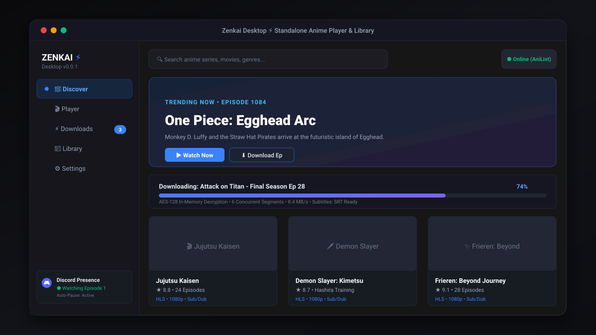
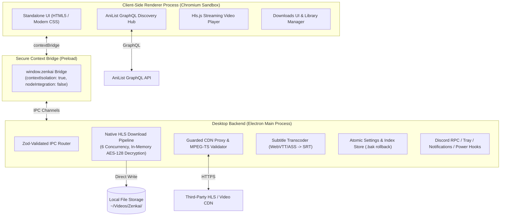

# Zenkai Desktop ⚡

[](https://github.com/johan-droid/Zenkai-Desktop-/actions/workflows/ci.yml)
[](https://github.com/johan-droid/Zenkai-Desktop-/actions/workflows/release.yml)
[](package.json)
[](electron-builder.yml)
[](tsconfig.json)
[](package.json)

---

## 1. Project Title & Branding

**Zenkai Desktop** is a premier, standalone desktop application engineered for seamless anime streaming, resilient offline downloading, and automated watch tracking with native Discord Rich Presence.

---

## 2. Short Project Introduction

Zenkai Desktop combines an isolated Electron runtime with an in-memory AES-128 HLS decryption engine, AniList GraphQL catalog discovery, and an accessible obsidian/claymorphic interface. It delivers a fast, desktop-native streaming experience that operates both as a full standalone client and as a companion shell for the Zenkai web portal.

---

## 3. Project Vision & Purpose

Desktop streaming applications often suffer from fragile web wrappers, memory leaks, and unverified third-party scripts. Zenkai Desktop was architected from the ground up to solve these issues:
* **Zero Runtime Leakage**: Renderer processes operate under strict sandbox isolation with zero Node.js execution capabilities in the DOM.
* **Resilient Offline Freedom**: In-memory decryption and local indexing ensure that downloaded media remains playable anywhere without active network connections or DRM friction.
* **Modern Desktop Integration**: Deep OS integration via system tray, native notifications, power state awareness, and Discord Rich Presence.

---

## 4. Key Verified Features

The following capabilities are fully implemented and verified in the current release:

* **🌟 AniList GraphQL Discovery**: Browse trending anime, seasonal populars, community ratings, and full episode guides with built-in offline catalog fallbacks.
* **🎬 High-Definition Streaming Player**: Hardware-accelerated HLS video engine powered by `hls.js`, supporting adaptive bitrates (1080p/720p/480p/360p), server failover, Sub/Dub audio tracks, Picture-in-Picture (PiP), and playback rate controls.
* **⚡ Native HLS & MPEG-TS Download Pipeline**:
  * Multi-connection concurrent segment downloading (up to 6 parallel connections per download job).
  * Safe **in-memory AES-128 decryption** — decryption keys and initialization vectors are processed strictly in RAM and never written to persistent disk.
  * Automated WebVTT/ASS subtitle downloading with instant transcoding into standard `.srt` format saved beside media files.
  * Resilient atomic download queue with automatic interrupt resumption and corruption recovery.
* **📁 Offline Media Library**: Downloaded episodes (`.ts`) are indexed and playable directly within the application with zero network connection.
* **⏸️ Auto-Pause Intelligence**: Automatically pauses video playback when the window is minimized or loses focus, and restores state seamlessly upon return. Also integrates with OS screen-lock and sleep detection hooks.
* **🎧 Discord Rich Presence (RPC)**: Real-time rich presence synchronization displaying your active show, episode number, and playback timestamp on Discord.
* **🌐 Web Portal Integration**: One-click toggle between Standalone Desktop UI and the Cloud Web Portal (`https://zenkai-web.pages.dev/`) with hotkeys (`Ctrl+Shift+D` and `Ctrl+Shift+W`).
* **🔒 Hardened Security Sandbox**: Deny-by-default navigation, strict Content Security Policy (CSP), origin allowlisting, zero Node/Electron leakage in renderer, and sanitized deep links.

---

## 5. UI Preview



*The Zenkai Desktop user interface featuring AniList discovery, the HLS playback engine, concurrent download queue, and live Discord status.*

---

## 6. Supported Platforms

| Operating System | Architecture | Supported Formats | Status |
|---|---|---|---|
| **Windows 10 / 11** | x64 (64-bit) | NSIS Installer (`.exe`), Portable Archive (`.zip`) | Verified & Supported |
| **Linux (Ubuntu, Debian)** | x64 (64-bit) | Portable AppImage (`.AppImage`), Debian Package (`.deb`) | Verified & Supported |
| **Linux (Fedora, RHEL, openSUSE)** | x64 (64-bit) | RPM Package (`.rpm`) | Built via Release Pipeline |
| **macOS (12+)** | Universal (Intel / Apple Silicon) | Disk Image (`.dmg`), Archive (`.zip`) | Build targets configured |

> [!NOTE]
> Windows ARM64 is not officially certified for this release. Only verified 64-bit x64 builds are distributed.

---

## 7. Download Section

Download official, pre-compiled release binaries directly from GitHub Releases:

👉 **[Download Latest Zenkai Desktop Release](https://github.com/johan-droid/Zenkai-Desktop-/releases)**

### Release Asset Manifest

| Asset Name | Target Platform | Description |
|---|---|---|
| `Zenkai-Desktop-v0.0.1-Windows-x64-Setup.exe` | Windows 10/11 x64 | Interactive NSIS installer with desktop & start menu shortcuts. |
| `Zenkai-Desktop-v0.0.1-Windows-x64-Portable.zip` | Windows 10/11 x64 | Zero-install standalone archive. Extract and run `Zenkai.exe`. |
| `Zenkai-Desktop-v0.0.1-Linux-x64.AppImage` | Linux x64 | Self-contained executable. Works across all modern distributions. |
| `Zenkai-Desktop-v0.0.1-Linux-x64.deb` | Ubuntu / Debian x64 | Native Debian package with desktop menu integration. |
| `Zenkai-Desktop-v0.0.1-Linux-x64.rpm` | Fedora / RHEL x64 | Native RPM package with desktop menu integration. |
| `SHA256SUMS.txt` | All Platforms | Authoritative cryptographic SHA-256 checksums for all release binaries. |

---

## 8. Windows Installation Instructions

### Option A: Standard Setup Installer (`.exe`)
1. Download `Zenkai-Desktop-v0.0.1-Windows-x64-Setup.exe`.
2. Double-click the installer to launch the setup wizard.
3. Choose your desired installation destination (default: `%LOCALAPPDATA%\Programs\Zenkai`).
4. Select whether to create a desktop shortcut and Start Menu folder.
5. Click **Install**. Once finished, launch Zenkai Desktop from your Start Menu.

> [!TIP]
> **Windows SmartScreen Note**: Since release binaries are not signed with an EV Code Signing certificate, Windows Defender SmartScreen may display a warning dialog on initial launch ("Windows protected your PC"). Click **More info** and then select **Run anyway**.

### Option B: Portable Distribution (`.zip`)
1. Download `Zenkai-Desktop-v0.0.1-Windows-x64-Portable.zip`.
2. Extract the ZIP archive to any directory (e.g., `C:\Apps\Zenkai`).
3. Run `Zenkai.exe` directly. No administrative privileges or registry changes are required.

### Uninstallation
* To remove the installed application, open **Settings > Apps > Installed apps**, locate **Zenkai Desktop**, and click **Uninstall**.
* Your personal configuration and downloaded media files remain safely in `%APPDATA%\zenkai-desktop` and `%USERPROFILE%\Videos\Zenkai` unless deleted manually.

---

## 9. Linux Installation Instructions

### Option A: AppImage (Universal Linux)
The AppImage requires no package manager and runs on nearly all Linux distributions (Ubuntu, Debian, Fedora, Arch Linux, openSUSE).

```bash
# 1. Download the AppImage
wget https://github.com/johan-droid/Zenkai-Desktop-/releases/download/v0.0.1/Zenkai-Desktop-v0.0.1-Linux-x64.AppImage

# 2. Grant executable permissions
chmod +x Zenkai-Desktop-v0.0.1-Linux-x64.AppImage

# 3. Launch Zenkai Desktop
./Zenkai-Desktop-v0.0.1-Linux-x64.AppImage
```

*(Optional: Use [AppImageLauncher](https://github.com/TheAssassin/AppImageLauncher) for automated desktop icon integration).*

### Option B: Debian / Ubuntu (`.deb`)
```bash
# 1. Download the Debian package
wget https://github.com/johan-droid/Zenkai-Desktop-/releases/download/v0.0.1/Zenkai-Desktop-v0.0.1-Linux-x64.deb

# 2. Install using dpkg or apt
sudo dpkg -i Zenkai-Desktop-v0.0.1-Linux-x64.deb
sudo apt-get install -f # Fix any missing dependencies if prompted
```

### Option C: Fedora / RHEL (`.rpm`)
```bash
# 1. Download the RPM package
wget https://github.com/johan-droid/Zenkai-Desktop-/releases/download/v0.0.1/Zenkai-Desktop-v0.0.1-Linux-x64.rpm

# 2. Install using dnf or rpm
sudo dnf install ./Zenkai-Desktop-v0.0.1-Linux-x64.rpm
```

### Linux Runtime Dependencies
Zenkai Desktop relies on standard desktop libraries (`glibc 2.31+`, `gtk3`, `nss`, `xdg-utils`). Desktop notifications are dispatched via standard Freedesktop notification daemons (`libnotify-bin`).

---

## 10. First-Launch Instructions

1. **Launch the Application**: Start Zenkai Desktop from your application launcher or terminal.
2. **Initial Setup**: On first run, Zenkai Desktop creates the necessary user data directory and an empty atomic settings file (`settings.json`).
3. **Configure Settings**:
   * Click **⚙️ Settings** in the left sidebar (or press `Ctrl+,`).
   * **Auto-Pause**: Toggle whether playback should automatically pause when the window is minimized or out of focus.
   * **Discord RPC**: Toggle Discord Rich Presence reporting.
   * **Download Directory**: By default, downloads are saved to your system's `Videos/Zenkai` folder. You can customize this path in settings.
4. **Network Access**: Ensure your firewall permits outbound HTTPS traffic on port 443 to stream providers and the AniList GraphQL API (`graphql.anilist.co`).

---

## 11. Configuration & Application Data Locations

Zenkai Desktop persists settings, download manifests, and cached metadata atomically. The locations follow standard OS conventions:

| Platform | Configuration & State Directory | Default Downloads Directory |
|---|---|---|
| **Linux** | `~/.config/zenkai-desktop/` | `~/Videos/Zenkai/` |
| **Windows** | `%APPDATA%\zenkai-desktop\` | `%USERPROFILE%\Videos\Zenkai\` |
| **macOS** | `~/Library/Application Support/zenkai-desktop/` | `~/Movies/Zenkai/` |

### Key Files in Data Directory:
* `settings.json`: User preferences (auto-pause, discord toggle, custom download paths). Atomically saved with `.bak` rollback protection.
* `downloads.json`: Manifest of completed, paused, and active offline media files.

---

## 12. System Requirements

* **Processor**: 64-bit dual-core Intel or AMD processor (2.0 GHz or higher).
* **Memory (RAM)**: 2 GB minimum (4 GB recommended for smooth 1080p 60fps playback).
* **Storage**:
  * 300 MB free space for application binaries and dependencies.
  * 500 MB – 2 GB additional space for caching and offline episode storage (~200–400 MB per episode).
* **Graphics**: Hardware video decoding recommended (Intel HD Graphics 4000+, AMD Radeon R5+, or NVIDIA GeForce 600+).
* **Network**: Broadband connection (minimum 5 Mbps for 720p, 15 Mbps for 1080p).

---

## 13. Architecture Overview

Zenkai Desktop follows a decoupled, three-tier architecture ensuring complete separation of concerns and robust security boundaries:



* **Main Process (`src/main/`)**: Controls the application lifecycle, IPC message routing, background stream resolution, in-memory AES-128 decryption, file I/O, and Discord Rich Presence.
* **Preload Bridge (`src/preload/index.ts`)**: Selectively exposes a typed, safe API subset via `contextBridge.exposeInMainWorld('zenkai', ...)`. Zero Node.js primitives or Electron internals are exposed to the DOM.
* **Renderer Process (`src/renderer/`)**: Modern client application managing playback state, views, responsive layouts, and user interactions.

---

## 14. Technology Stack

* **Application Runtime**: Electron 45.3.2
* **Build Tooling & Bundling**: electron-vite 6.0.0, Vite 5.x
* **Language & Compiler**: TypeScript 7.0.2 (strict mode enabled)
* **Packaging Engine**: electron-builder 26.18.0
* **Media Playback**: Hls.js 1.7.4 (adaptive streaming)
* **Schema Validation**: Zod 4.6.7
* **Desktop Integrations**: `@xhayper/discord-rpc` 1.5.1
* **Testing & QA**: Vitest 5.1.0, Playwright 1.65.1

---

## 15. Development Setup

### Prerequisites
* **Node.js**: `v22.x` or higher
* **Package Manager**: `pnpm` (v12 recommended)
* **Linux Build Dependencies**: `libnotify-bin`, `libnotify-dev`, `rpm`

### Clone and Install
```bash
# Clone the repository
git clone https://github.com/johan-droid/Zenkai-Desktop-.git
cd Zenkai-Desktop-

# Install locked dependencies
pnpm install --frozen-lockfile
```

---

## 16. Local Build & Verification Instructions

### Run in Development Mode
Launch Electron with Hot-Module Replacement (HMR):
```bash
pnpm dev
```

### Run Automated Quality Verification
Execute the comprehensive test suites before committing changes:
```bash
# 1. Strict TypeScript check (0 errors required)
pnpm typecheck

# 2. Static code analysis (ESLint)
pnpm lint

# 3. Unit test suite (66 tests across 11 suites)
pnpm test

# 4. Playwright End-to-End integration suite (under xvfb on Linux)
xvfb-run -a pnpm e2e
```

### Compile & Package Release Binaries
```bash
# Compile and bundle with electron-vite
pnpm build

# Build Linux packages (AppImage and .deb)
pnpm dist:linux

# Build Windows packages (on Windows runner or wine)
pnpm dist:win
```

---

## 17. Contribution Guidelines

We welcome contributions from the open-source community!

1. **Fork the Repository**: Create a personal fork on GitHub.
2. **Create a Feature Branch**: Work on a descriptive branch (e.g., `feature/custom-themes` or `fix/hls-reconnection`).
3. **Commit Cleanly**: Follow Conventional Commits conventions:
   * `feat: add playback speed memory`
   * `fix: handle corrupt media playlist header`
   * `docs: update linux installation steps`
4. **Ensure All Checks Pass**: Verify `pnpm typecheck`, `pnpm lint`, `pnpm test`, and `pnpm e2e` pass before opening your pull request.
5. **Open a Pull Request**: Submit your PR against the `main` branch with a clear description of the problem solved.

---

## 18. Bug Reporting & Feature Requests

* **Reporting Bugs**:
  * Check existing [GitHub Issues](https://github.com/johan-droid/Zenkai-Desktop-/issues) to confirm the issue hasn't been reported.
  * Provide complete system specifications: OS name and version, GPU model, Zenkai Desktop version (`0.0.1`), and steps to reproduce.
  * Attach application logs from your terminal or developer console where applicable.
* **Requesting Features**:
  * Open an issue with the `[Feature Request]` tag.
  * Describe the proposed feature, the use case, and any relevant mockups or user flows.

---

## 19. Security Reporting Instructions

Security and data integrity are top priorities for Zenkai Desktop.

If you discover a security vulnerability or sandbox escape:
* **Do NOT report security issues via public GitHub issues.**
* Submit a private vulnerability disclosure via GitHub Security Advisories or email the engineering team directly at `dev@zenkai.cfd`.
* Please include a proof-of-concept, description of impact, and steps to reproduce. We will acknowledge receipt within 48 hours and work with you on a coordinated fix and release.

---

## 20. Roadmap

### Completed in v0.0.1
- [x] Decoupled standalone client architecture with AniList GraphQL discovery.
- [x] Hardware-accelerated Hls.js player with multi-source resolution and Sub/Dub switching.
- [x] High-performance multi-connection HLS downloader with in-memory AES-128 decryption.
- [x] Subtitle fetching and automated WebVTT/ASS to SRT transcoding.
- [x] Native Discord Rich Presence integration.
- [x] Auto-pause functionality on blur, minimize, lock, and suspend.
- [x] Cross-platform packaging for Linux (AppImage, deb, rpm) and Windows (NSIS, portable zip).
- [x] Hardened security isolation (strict CSP, navigation lockdown, Zod IPC validation).

### Planned Future Enhancements
- [ ] Cross-device watch progress synchronization via optional self-hosted sync server.
- [ ] Integrated custom playback playlist and queue manager.
- [ ] Configurable proxy support (SOCKS5 / HTTP) for restricted network environments.
- [ ] Keyboard shortcut customization matrix.
- [ ] Hardware-accelerated video decoding toggles in settings.

---

## 21. License Information

Zenkai Desktop is proprietary software maintained by the Zenkai Desktop development team.
All rights reserved. See `package.json` for license identifier (`UNLICENSED`).

---

## 22. Acknowledgements & Upstream Attribution

Zenkai Desktop is built upon incredible open-source technologies:
* **Nyyrox / Zenkai**: Upstream core architecture and vision for the Zenkai anime ecosystem.
* **[Electron](https://www.electronjs.org/)**: Cross-platform desktop application framework.
* **[AniList API](https://anilist.gitbook.io/anilist-apiv2-docs/)**: Comprehensive anime metadata and media discovery GraphQL services.
* **[Hls.js](https://github.com/video-dev/hls.js/)**: Robust JavaScript HLS client for HTML5 video playback.
* **[electron-builder](https://www.electron.build/)**: Complete desktop packaging and distribution system.
* **[Discord RPC](https://github.com/xhayper/discord-rpc)**: Rich presence integration for Discord.
