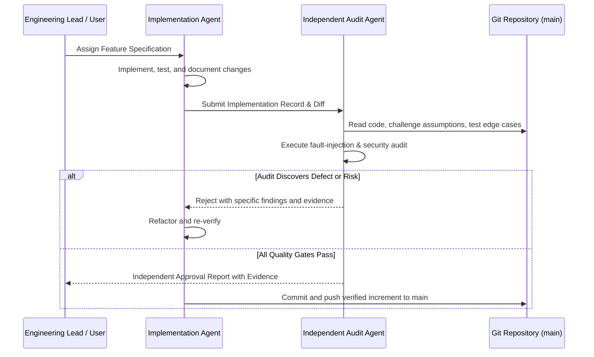

# ZENKAI DESKTOP — MANDATORY ENGINEERING QUALITY, FEATURE LIFECYCLE, UI CONSISTENCY & CONTROLLED ROLLOUT STANDARD

**Document Path:** `docs/ENGINEERING_QUALITY_GATES.md`  
**Status:** Non-Negotiable Engineering Standard  
**Authority:** Master Engineering Policy for All Zenkai Desktop Contributors and AI Agents  
**Target Branch:** `main` (Strict Rule: Zero rogue feature branches; direct-to-main verified increments)

---

## Preamble & Scope

This specification establishes the mandatory, binding engineering quality standards for the Zenkai Desktop project. It extends the existing Zenkai Desktop feature audit, website parity, desktop feature expansion, and update-management architecture.

This standard applies unconditionally to:
- Every existing feature being repaired or refactored.
- Every new feature being introduced.
- Every frontend React component, hook, context, and stylesheet.
- Every backend service integration and API client.
- Every Electron main-process capability and background manager.
- Every IPC contract, handler, and preload bridge method.
- Every download workflow, file-system operation, and cache.
- Every playback pipeline, shader, and subtitle renderer.
- Every synchronization operation with external backends.
- Every update-manager function, manifest verification, and rollback.
- Every configuration, schema, and persistence change.

> [!IMPORTANT]
> **The Non-Negotiable Quality Rule**  
> No feature is considered complete merely because its code compiles, a linter passes, or a basic happy-path unit test succeeds. Quality, visual consistency, recoverability, and user trust take absolute precedence over shipping speed.

---

## 1. Strict 14-Stage Development Lifecycle

Every feature, repair, or subsystem modification must systematically proceed through all 14 stages of this lifecycle in order:

```mermaid
flowchart LR
    D1[1. DISCOVER] --> D2[2. SPECIFY]
    D2 --> D3[3. DESIGN]
    D3 --> D4[4. IMPLEMENT]
    D4 --> D5[5. UNIT TEST]
    D5 --> D6[6. INTEGRATION TEST]
    D6 --> D7[7. UI VALIDATION]
    D7 --> D8[8. LIFECYCLE TEST]
    D8 --> D9[9. STRESS TEST]
    D9 --> D10[10. SECURITY AUDIT]
    D10 --> D11[11. REGRESSION TEST]
    D11 --> D12[12. RELEASE CANDIDATE]
    D12 --> D13[13. CONTROLLED ROLLOUT]
    D13 --> D14[14. MONITOR & APPROVE]
```



### Stage Requirements:
1. **DISCOVER**: Inspect the existing codebase, identify current behavior, trace dependencies, locate authoritative sources, and establish baseline performance and UX metrics.
2. **SPECIFY**: Formulate an explicit specification detailing inputs, outputs, error conditions, and user expectations.
3. **DESIGN**: Design the software architecture, data structures, UI mockups, and state machines, adhering to deep-module design and existing UI patterns.
4. **IMPLEMENT**: Write minimal, clean, type-safe code that directly fulfills the specification.
5. **UNIT TEST**: Write exhaustive unit tests verifying individual functions, schemas, and edge cases.
6. **INTEGRATION TEST**: Verify that interconnected modules (e.g., IPC main-to-preload-to-renderer, database, network) communicate correctly.
7. **UI VALIDATION**: Visually validate the user interface across resolutions, themes, scaling factors, and interactive states.
8. **LIFECYCLE TEST**: Exercise the feature across all 15 operational states (see Section 4).
9. **STRESS TEST**: Subject the implementation to load, concurrency, burst traffic, and soak testing (see Section 5).
10. **SECURITY AUDIT**: Re-audit the attack surface, IPC privileges, input sanitization, and cryptographic guarantees (see Section 7).
11. **REGRESSION TEST**: Execute the comprehensive regression suite to guarantee no existing subsystem was degraded.
12. **RELEASE CANDIDATE**: Build the packaged binary targets (AppImage, deb, rpm, exe, dmg) in production mode.
13. **CONTROLLED ROLLOUT**: Deploy following the staged cohort schedule (Canary 1% → 5% → 25% → 50% → 100%).
14. **MONITOR & APPROVE**: Monitor telemetry, error rates, and crash diagnostics. Approve promotion to the next stage or trigger instant rollback.

### Implementation Record Requirement
Before writing code, create an Implementation Record identifying:
- **Feature Owner**: Lead engineer or agent identifier.
- **Requirements**: Functional and non-functional goals.
- **Dependencies**: Internal modules and external services.
- **Files & Components Affected**: Exact file paths and line ranges.
- **Data Models Affected**: Database schemas, JSON files, local storage keys.
- **API & IPC Changes**: Method signatures, request/response payloads, events.
- **UI States**: Visual representation of all operational states.
- **Security Boundaries**: Context isolation, validation rules, permissions.
- **Failure Modes**: Anticipated failure scenarios and mitigation plans.
- **Test Coverage Plan**: Unit, integration, and E2E targets.
- **Performance Expectations**: Latency, CPU, RAM budgets.
- **Rollback Strategy**: Precise mechanism to deactivate or roll back safely.

---

## 2. Dual-Agent Engineering Protocol

For all high-risk, architectural, security-sensitive, or complex feature additions, Zenkai Desktop enforces a **Dual-Agent Verification Protocol**:



### Roles and Responsibilities:
- **Implementation Agent**:
  - Builds the feature according to the approved specification.
  - Implements the unit, integration, and UI tests.
  - Drafts the initial Feature Completion Report.
- **Independent Audit Agent**:
  - Operates with an adversarial, quality-first mindset.
  - Reviews every changed line of code without assuming the implementation agent's checklist is complete.
  - Directly executes tests, probes failure scenarios, validates taint traces, and inspects visual consistency.
  - Has full veto power to block a release candidate if any quality gate is breached.

---

## 3. Strict UI Consistency — Zero Visual Regression

The authentic React 19 source from `nyyrox2/Zenkai` serves as the authoritative visual standard for the Zenkai Desktop renderer.

```
NO UNRELATED VISUAL LANGUAGES.
NO GENERIC DASHBOARD STYLING.
NO OVERSIZED CARDS OR IRRELEVANT WIDGETS.
NO UNNECESSARY GRADIENTS OR RANDOM ACCENT COLORS.
NO EXCESSIVE OR SLUGGISH ANIMATIONS.
```

### 3.1 Design Authority Inspection Checklist
Before adding or modifying any UI component, inspect and conform to:
1. **Typography**: Inter/system font stack, exact font sizes, line heights, and letter spacing.
2. **Color Tokens**: CSS custom properties and Tailwind semantic classes (`bg-background`, `text-foreground`, `border-border`, `bg-card`).
3. **Spacing Conventions**: Strict multiples of 4px (`p-2`, `p-4`, `gap-3`, `gap-6`).
4. **Borders & Radii**: Standard rounded utility classes (`rounded-lg`, `rounded-xl`, `border-white/10`).
5. **Button Styles**: Primary, secondary, ghost, icon-btn styles matching existing buttons.
6. **Input & Form Styles**: Identical placeholder colors, focus rings (`ring-primary`), and error states.
7. **Modal & Popover Patterns**: Framer Motion presence wrappers, backdrop blur (`backdrop-blur-md`), and escape key handling.
8. **Loading & Skeleton States**: Shimmer animation gradients matching `Skeleton.tsx`.
9. **Navigation & Layout Conventions**: Preserved `DesktopSidebar`, `MobileDock`, and content padding.
10. **Animation & Transition Patterns**: Fast, purposeful transitions (150ms–200ms ease-out). No gratuitous physics loops.
11. **Responsive Behavior**: Graceful layout reflow from compact windows (960px) to ultra-wide displays (4K).
12. **Theme Consistency**: High contrast, readable text in dark and light modes.

### 3.2 Visual Hierarchy Invariants
- **Content First**: UI chrome must never distract from discovering or watching anime, reading manga, or reading novels.
- **No Intrusive Modals**: Background activities (downloads, sync, update checks) must remain unobtrusive.
- **Proportionate Controls**: Secondary actions must remain visually secondary.
- **Reduced Motion**: Respect `prefers-reduced-motion` across all components.

### 3.3 UI Validation Matrix
Every UI addition must be tested against:
- High-DPI displays (100%, 125%, 150%, 200% scaling).
- Compact window size (960x600 minimum) and maximized desktop window.
- Empty states (no downloads, no history, no search results).
- Long text strings and unusual character sets (Japanese kanji, emoji, extended titles).
- Keyboard navigation (Tab order, Enter/Space activation, Escape dismissal).
- Focus rings visible for accessibility.

---

## 4. Full 15-State Feature Lifecycle Testing

Every subsystem must define and test its behavior across all 15 operational states:

| State # | Operational State | Invariant / Requirement |
|---|---|---|
| **1** | **Initial** | Clean default state before any user or network action. |
| **2** | **Loading** | Accessible loading spinner or skeleton placeholder; interactive controls disabled to prevent double-clicks. |
| **3** | **Ready** | Fully loaded, valid data mounted, interactive controls responsive. |
| **4** | **Active** | Process executing (e.g. video rendering, download chunk streaming, update checking). |
| **5** | **Paused** | Process suspended without dropping state or memory (e.g. video paused, download throttled). |
| **6** | **Empty** | Legitimate zero-state (e.g. no downloaded episodes, empty watchlist); displays helpful call-to-action. |
| **7** | **Success** | Successful operation termination with deterministic UI feedback. |
| **8** | **Failure** | Handled error with human-readable explanation, actionable recovery button, and error logging. |
| **9** | **Retry** | Bounded exponential backoff with jitter; prevents thundering-herd storms. |
| **10** | **Cancellation** | User or system abort; immediate cleanup of active resources, file handles, and abort controllers. |
| **11** | **Interrupted** | Sudden disconnection, power outage simulation, or network change; graceful degradation. |
| **12** | **Recovery** | Deterministic return to a consistent state following an interruption. |
| **13** | **Persistence** | Data safely committed to disk (atomic write via `.tmp` -> rename); no partial state corruption. |
| **14** | **Restart Restoration** | Application relaunch successfully restores pending queues, watch positions, or cached sessions. |
| **15** | **Cleanup & Disposal** | Component unmount or process exit releases event listeners, timers, sockets, and buffers. |

### Concrete Lifecycle Specifications:

#### A. Playback Lifecycle
```
Select Title → Fetch AniList Mapping → Resolve Canonical Stream → Select Server → Start HLS Playback 
→ Active Playback Guard Enabled → Pause → Resume → Seek → Switch Audio (Sub/Dub) → Switch Subtitles 
→ Complete Episode → Advance Next Episode → Close Window → Restore Resume Position on Relaunch
```

#### B. Download Lifecycle
```
Queue Download → Check Disk Budget (>2.5x size) → Allocate Slot (<3 active) → Stream HLS Segments (.part)
→ Atomic Progress Sync (downloads.json) → Fetch & Embed Subtitles → Assemble Final Media File 
→ Update Taskbar Progress → Notify Complete → Open / Delete Offline File
```

#### C. Update Lifecycle
```
Check Release (GitHub API / Manifest) → Match Dual-Channel (stable/beta) → Check Active Playback Guard 
→ If Active: Defer → If Idle: Notify User → Download Artifact → Verify SHA-256 Checksum 
→ Stage into userData/renderer-updates/staged → Atomic Swap to active → 5-Second Canary Health Check 
→ If Crash: Instant Rollback to previous → If Success: Mark Active
```

---

## 5. Aggressive Stress Testing, Soak Testing & Resource Budgets

Every critical subsystem must undergo rigorous stress testing prior to release.

### 5.1 Application-Level Stress Testing
- **Session Duration**: Continuous 8-hour soak testing simulating continuous anime playback, browsing, and background downloading.
- **Rapid User Interaction**: Scripted automated monkeys executing rapid tab-switching, search debouncing stress (50 queries/sec), and rapid episode navigation.
- **Large Dataset Testing**:
  - Library with 5,000+ anime titles.
  - Watch history with 10,000+ entries.
  - Download queue with 100+ episodes.
- **Leak Detection**:
  - Zero memory growth over continuous 2-hour idle session (< 5MB delta).
  - Main-process memory ceiling: < 150 MB idle.
  - Renderer memory ceiling: < 250 MB browsing, < 650 MB active 4K upscaled playback.
  - IPC listeners verified: zero duplicate listener warnings (`MaxListenersExceededWarning`).

### 5.2 Network & Service Stress Testing
- **Concurrency**: 20 simultaneous API requests to stream proxy and mapping resolvers.
- **Slow Links & Timeouts**: Simulated 50 kbps 2G network, 5,000ms latency, and connection resets.
- **Malformed Upstream Responses**: Ingestion of corrupt JSON, truncated HLS playlists, invalid chunk headers.
- **Rate Limit Throttling**: Verification that HTTP 429 triggers exponential backoff without crashing the client.

### 5.3 Resource Budgets

| Metric | Budget Ceiling | Verification Tool |
|---|---|---|
| **Cold Startup Time** | < 1,200 ms | Playwright launch benchmark |
| **Idle RAM (Main + Renderer)** | < 350 MB | Process memory inspector |
| **Active Playback CPU** | < 15% (Modern Quad-Core) | System monitor / htop |
| **Search Query Latency** | < 180 ms (Local cache) / < 600 ms (Network) | Performance.now() telemetry |
| **Stream Resolution to First Frame** | < 1,500 ms (Broadband) | Video timeupdate event |
| **OTA Renderer Activation** | < 250 ms (Atomic file rename) | Filesystem benchmark |

---

## 6. Fault Injection & Recovery Testing

Zenkai Desktop must be tested against simulated chaos:

1. **Network Disconnection During Active Download**: Verify `.part` file remains valid and resumes from last segment upon reconnection.
2. **Abrupt Process Termination (`kill -9`)**: Verify `settings.json`, `downloads.json`, and OTA directories suffer zero corruption.
3. **Corrupt Storage Recovery**: Write corrupted JSON to `settings.json` and verify automatic backup to `.bak` and reset to schema defaults.
4. **OTA Load Failure**: Inject broken JavaScript into `active/index.html` and verify the 5-second canary health check instantly restores the bundled baseline.
5. **Disk Space Exhaustion**: Simulate full disk condition and verify graceful error notification without crash.
6. **Corrupt Update Artifact**: Tamper with a downloaded update zip and verify SHA-256 verification rejects the package before extraction.

---

## 7. Mandatory Security Audit After Implementation

A mandatory security review must be conducted after every feature modification:

### Audit Surface Checklist:
- [ ] **Context Isolation**: `contextIsolation: true` strictly enforced on all windows.
- [ ] **Node Integration**: `nodeIntegration: false` strictly enforced in renderer.
- [ ] **Preload Hardening**: Exactly 9 sanctioned keys exposed on `window.zenkai` via `contextBridge`. No raw IPC dispatchers leaked.
- [ ] **Input Validation**: All IPC handlers parse inputs using strict Zod schemas.
- [ ] **Path Traversal Defense**: All file paths sanitized with `sanitizeFilename()` and checked against traversal attacks (`../`).
- [ ] **Cryptographic Verification**: Update manifests and artifacts verified via SHA-256 digests and Ed25519 digital signatures.
- [ ] **Navigation Lockdown**: WebContents navigation event handlers intercept and block unauthorized URL redirects.
- [ ] **CSP Enforcement**: Content Security Policy blocks arbitrary external script execution.

---

## 8. Regression Testing Matrix

Before any change is committed to `main`, the following regression matrix must be verified:

| Subsystem | Key Verification Check | Automated Suite |
|---|---|---|
| **Shell & Lifecycle** | App boots, single-instance lock honored, graceful shutdown | `scripts/t4-bridge-check.mjs` |
| **Security Hardening** | Navigation restricted, CSP enforced, isolation active | `scripts/t3-security-check.mjs` |
| **Playback & Streaming** | AniList ID 21 (One Piece) resolves deterministic stream | `tests/unit/playback-correctness.test.ts` |
| **Download Engine** | Queuing, concurrent limit (3), resume, subtitle extraction | `tests/unit/downloads.test.ts` |
| **Updater & Canary** | OTA canary rollback, playback guard, Linux deb/rpm download | `tests/unit/updater.test.ts`, `canary-health.test.ts` |
| **Settings & Storage** | Schema validation, defaults, atomic writes, backup on corruption | `tests/unit/settings.test.ts`, `settings-ipc.test.ts` |
| **E2E Integration** | Full Electron launch, player mounting, deep link callbacks | `playwright test` (8 tests) |

---

## 9. Controlled Release, Staged Rollout & Emergency Kill-Switch

### 9.1 Staged Rollout Sequence
New releases are distributed gradually using deterministic MurmurHash3 cohort assignment:

```
Stage 0: Internal Developer Testing (0%)
Stage 1: Automated QA & E2E Validation (0%)
Stage 2: Beta Channel Opt-In (Beta Cohort)
Stage 3: 1% Production Canary
Stage 4: 5% Production Rollout
Stage 5: 10% Production Rollout
Stage 6: 25% Production Rollout
Stage 7: 50% Production Rollout
Stage 8: 100% General Availability
```

### 9.2 Promotion Criteria
Promotion between stages requires:
- Crash-free user sessions > 99.8%.
- Playback initiation failure rate < 0.5%.
- Update installation failure rate < 0.1%.
- Zero reported data corruption issues.

### 9.3 Emergency Kill-Switch & Rollback
If a critical defect is discovered:
- **Instant Revocation**: Mark release tag `revoked: true` on GitHub Release / manifest.
- **Client Auto-Rollback**: Clients receiving revocation immediately roll back to `previous` or bundled baseline.
- **Rollout Halt**: Immediate freeze of cohort promotion.

---

## 10. The 12 Release Gates

A release cannot be tagged, published, or distributed unless every single gate passes:

- **GATE 1**: Requirements & Architecture approved in writing.
- **GATE 2**: Implementation reviewed and adheres to deep-module design.
- **GATE 3**: 100% of unit and integration tests pass.
- **GATE 4**: Complete 15-state lifecycle verified with automated tests.
- **GATE 5**: Stress, concurrency, and soak tests pass within resource budgets.
- **GATE 6**: Security audit passed with zero High or Critical vulnerabilities.
- **GATE 7**: UI consistency, typography, and accessibility verified visually.
- **GATE 8**: Full regression test suite passes with zero regressions.
- **GATE 9**: Packaged application tested on Linux, Windows, and macOS targets.
- **GATE 10**: Rollback, recovery, and corruption handlers verified.
- **GATE 11**: Canary cohort metrics satisfy production health criteria.
- **GATE 12**: Final production release approval signed off by repository owner.

---

## 11. Mandatory Agent Behaviors & Git Protocol

All coding agents operating on Zenkai Desktop must strictly follow these behavioral mandates:

1. **Inspect Before Changing**: Read existing implementations, types, and styles before proposing changes.
2. **Zero Visual Slop**: Match existing typography, colors, radii, and component patterns exactly.
3. **Evidence-First Truthfulness**: Never claim a test passed, a check succeeded, or a screen matched without running the command and inspecting the output.
4. **Preserve User Data**: Treat user settings, watch progress, and downloads as sacrosanct. Never delete or overwrite user data destructively.
5. **Git Branch Protocol**:
   - **Strict Rule**: Push directly to `main` branch in clean, verified increments unless explicitly instructed by the repository owner to create a branch.
   - Every commit to `main` must compile cleanly and pass 100% of test suites.
   - Commit messages must follow Conventional Commits (`feat(module): description`, `fix(module): description`).

---

## 12. Final Feature Completion Report Template

For every completed feature or major subsystem repair, the implementing agent must generate this standardized report:

```markdown
# Feature Completion Report: [Feature Name]

## 1. Requirement & Scope
- **Original Requirement**: [Brief description of what was requested]
- **Implemented Scope**: [Exact capabilities delivered]

## 2. Changes Summary
- **Files Modified / Added**:
  - `src/path/to/file.ts`: [What changed]
- **API & IPC Changes**: [Channels added or updated]
- **Data Models / Schemas**: [Schema modifications]

## 3. UI Consistency & Design Verification
- **Existing Components Reused**: [List of reused UI components]
- **Typography & Colors**: [Confirmed match to existing tokens]
- **Window Sizes & Themes Tested**: [960px, 1080p, 4K; Dark / Light]
- **Visual Evidence**: [Screenshots / visual check results]

## 4. Lifecycle & State Coverage
- **15 States Tested**: [List states verified: Initial, Active, Paused, Error, Recovery, etc.]
- **Failure & Interruption Handling**: [Observed behavior during simulated failure]

## 5. Verification Test Evidence
- **Unit Tests**: [Test file name] — [X/X tests passing]
- **Integration Tests**: [Test file name] — [X/X tests passing]
- **E2E / Playwright**: [X/X tests passing]
- **T4 Bridge Check**: [5/5 passing]
- **T3 Security Check**: [5/5 passing]

## 6. Resource & Stress Measurements
- **Idle Memory**: [Measured MB]
- **Active Playback Memory**: [Measured MB]
- **CPU Utilization**: [Measured %]

## 7. Security Audit
- **Preload Isolation**: [9 sanctioned keys confirmed]
- **Input Sanitization**: [Zod schemas / sanitizeFilename confirmed]
- **Security Findings**: [Zero High/Critical]

## 8. Rollout & Rollback Readiness
- **Release Channel**: [stable / beta]
- **Rollback Mechanism**: [Canary 5s auto-rollback / manual fallback]

## 9. Final Status
[NOT STARTED | IN PROGRESS | IMPLEMENTED — NOT VERIFIED | VERIFIED IN TEST ENVIRONMENT | CANARY APPROVED | PRODUCTION APPROVED | BLOCKED | ROLLED BACK]
```

---

*This document represents the permanent engineering policy of Zenkai Desktop. Every task, commit, and pull request is bound by these requirements.*

