# Zenkai Desktop — Release & Distribution Process

This document outlines the standard, automated release pipeline for **Zenkai Desktop** across Linux, Windows, and macOS.

---

## 1. Release Philosophy

Zenkai Desktop adheres to [Semantic Versioning (SemVer 2.0.0)](https://semver.org/):
- **Major (`X.0.0`)**: Incompatible runtime, architecture, or IPC breaking changes.
- **Minor (`0.X.0`)**: New backward-compatible desktop features (e.g., new reader modes, download features).
- **Patch (`0.0.X`)**: Backward-compatible bug fixes, security patches, and performance optimizations.

---

## 2. Dual-Track Release Architecture

Zenkai Desktop employs a two-track update and release system:

```mermaid
flowchart TD
    subgraph Track_A["Track A: Website Renderer Updates (OTA)"]
        W1[Frontend Web Changes] --> W2[Build Web Bundle]
        W2 --> W3[Generate manifest.json & SHA-256]
        W3 --> W4[Publish to Cloudflare Pages / GitHub CDN]
        W4 --> W5[Desktop Client Fetches & Verifies]
        W5 --> W6[5-Second Canary Health Check & Rollback]
    end

    subgraph Track_B["Track B: Native Desktop Runtime (Electron)"]
        D1[Electron / Native Node / IPC Changes] --> D2[Bump package.json version]
        D2 --> D3[Push Git Tag: vX.Y.Z]
        D3 --> D4[GitHub Actions Release Matrix CI]
        D4 --> D5[Build Linux, Windows & macOS Installers]
        D5 --> D6[Generate SHA256SUMS.txt & Publish GitHub Release]
    end
```

### Track A: Over-The-Air (OTA) Renderer Updates
- For UI improvements, CSS fixes, and upstream server adapter updates.
- Instantly downloaded by connected desktop clients into `userData/renderer-updates/staged`.
- Verified against the published SHA-256 digest before atomic activation.
- **Canary Guard**: Monitored for 5 seconds after launch. Any crash or fatal loading failure automatically triggers an instant rollback to the previous build or the bundled offline fallback.

### Track B: Native Electron Runtime Releases
- For Electron upgrades, Node.js runtime changes, Preload bridge updates, or native system integration changes.
- Distributed via GitHub Releases.
- **Windows**: Differential and full NSIS setup installer (`.exe`) and portable archive (`.zip`).
- **Linux (AppImage)**: In-place auto-updating binary via `electron-updater`.
- **Linux (DEB / RPM)**: Downloaded directly into user's `Downloads` folder with one-click installation trigger.
- **macOS**: Universal DMG and portable archive (`.zip`).

---

## 3. Automated CI/CD Release Pipeline

When a version tag is pushed (e.g. `git push origin v0.0.2`):

1. **GitHub Actions Matrix Workflow (`.github/workflows/release.yml`)**:
   - **`build-linux` (Ubuntu 22.04)**: Builds `Zenkai-Desktop-*.AppImage`, `.deb`, and `.rpm`. Generates `checksums-linux.txt`.
   - **`build-windows` (Windows Latest)**: Builds `Zenkai-Desktop-*.exe` (NSIS) and `.zip`. Generates `checksums-windows.txt`.
   - **`build-macos` (macOS 14)**: Builds `Zenkai-Desktop-*.dmg` and `.zip`. Generates `checksums-macos.txt`.
2. **`publish-release` Job**:
   - Gathers all binary artifacts from the matrix build.
   - Combines checksums into an authoritative `SHA256SUMS.txt`.
   - Validates that every binary artifact is non-empty (`test -s`).
   - Publishes the final release on GitHub Releases with auto-generated release notes.

---

## 4. Release Checklist Before Tagging

- [ ] All 109+ Vitest unit tests pass (`pnpm test`).
- [ ] T4 preload bridge contract check passes 5/5 (`node scripts/t4-bridge-check.mjs`).
- [ ] T3 security check passes 5/5 (`node scripts/t3-security-check.mjs`).
- [ ] Playwright E2E suite passes 8/8 (`pnpm exec playwright test`).
- [ ] `pnpm build` completes with 0 errors across main, preload, and renderer.
- [ ] `eslint .` passes with 0 warnings or errors.
- [ ] `CHANGELOG.md` is updated with all notable additions, fixes, and changes.
- [ ] `package.json` version matches the release target.

