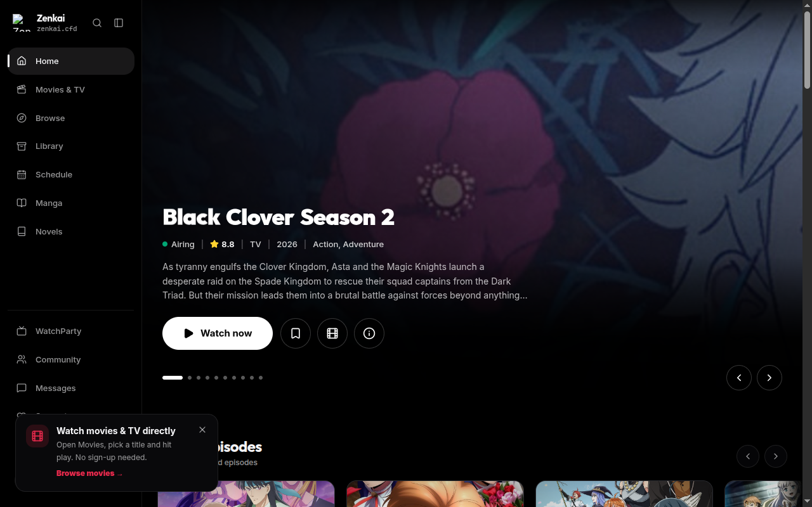
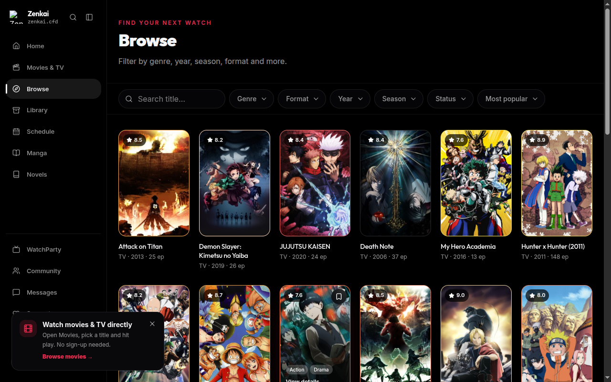
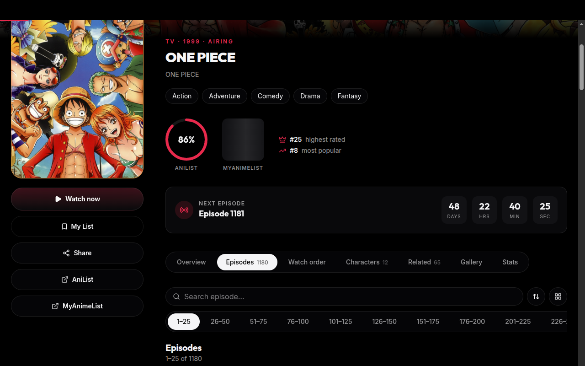
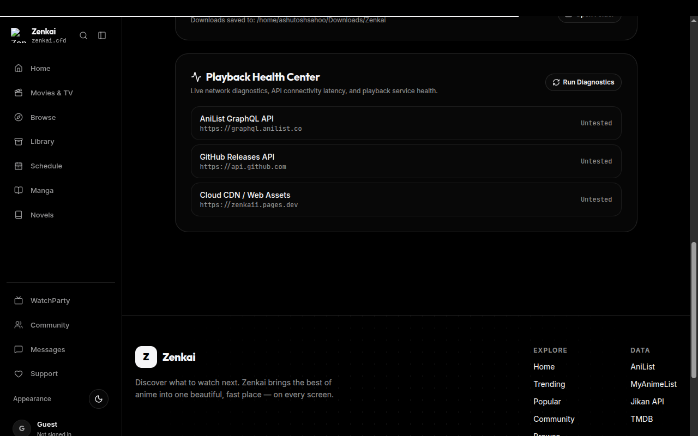
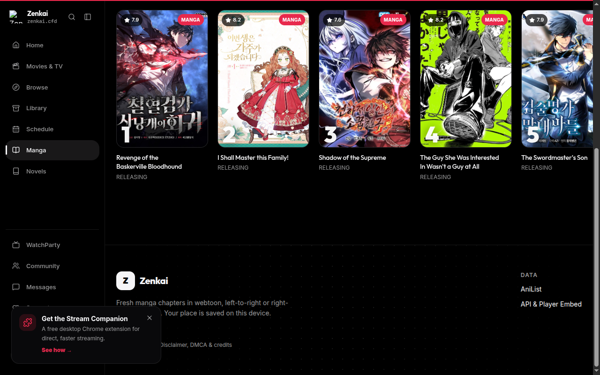
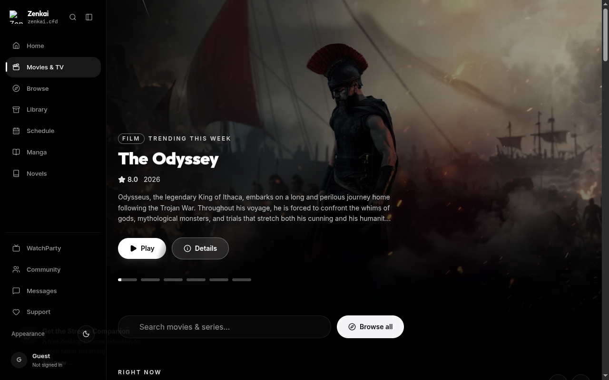

# Zenkai Desktop — Visual Walkthrough & Screenshots

All screenshots below were captured directly from the running **Zenkai Desktop** application window (1280x800 resolution) using Playwright automation against the production build.

---

## 1. Discover & Home Screen

*The Zenkai Desktop home screen featuring the persistent collapsible DesktopSidebar, spotlight hero banner, trending anime rows, and continue-watching tracker.*

---

## 2. Anime Catalog & Browse

*Catalog view powered by AniList GraphQL, featuring comprehensive filters (season, year, format, genre), search input, and responsive anime card grid with hover animations.*

---

## 3. Anime Details & Episode Selector

*Detailed view for One Piece (AniList ID: 21), showing banner artwork, synopsis, character cards, episode list selector, and primary stream actions.*

---

## 4. Desktop Settings, Update Management & Playback Health Center

*The native desktop settings panel featuring dual-channel release selection (Stable vs Beta), interactive update checking, active playback protection notice, native hardware acceleration toggles, download storage folder selector, and live Playback Health Center latency diagnostics.*

---

## 5. Manga Reader & Catalog

*Integrated manga discovery and reader interface supporting continuous vertical webtoon scroll, single-page reading, chapter cache, and reading progress synchronization.*

---

## 6. Movies & TV Series

*Movies and TV section integrating TMDB catalog data, season/episode browsing, and streaming server options.*

---

*Note: All images in this document are authentic captures of the actual desktop application built from `johan-droid/Zenkai-Desktop-`.*

