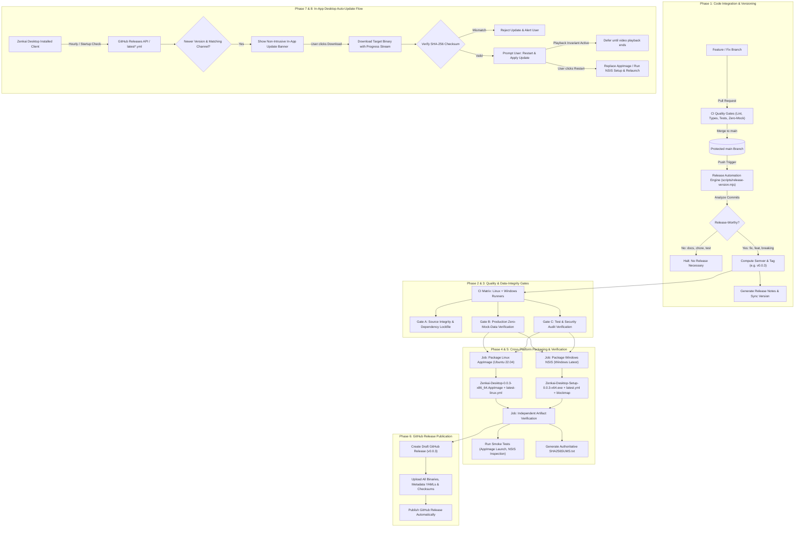

# Zenkai Desktop — Fully Automated Production Release Architecture

**Document Version:** 1.0.0  
**Target Platform:** Linux x86_64 (AppImage) & Windows x64 (NSIS Installer)  
**System Type:** Production-Grade Cross-Platform Release & Auto-Update Infrastructure  
**Status:** Approved Architecture Specification  

---

## 1. System Vision & Philosophy

The Zenkai Desktop release and update infrastructure delivers continuous, safe, hands-free distribution of production desktop software. 

### Core Release Philosophy
> **"Automate delivery, never bypass quality gates."**

1. **Zero Manual Packaging:** Releases are deterministically compiled, packaged, signed, verified, and published by GitHub Actions runners without requiring human asset assembly or manual release button clicks.
2. **Strict Quality Gates:** Every step in the lifecycle—from commit analysis to in-client binary execution—is guarded by unskippable verification gates. If any gate fails, the release is aborted immediately.
3. **Notify-First User Autonomy:** The desktop application never silently replaces running binaries or forcibly interrupts active video playback. Users are informed of updates, view honest changelogs, inspect real download progress, and decide when to restart.
4. **Cryptographic Integrity by Default:** Downloaded updates are strictly validated via HTTPS, SHA-256 checksums, and version assertions before execution.

---

## 2. End-to-End Release Architecture



---

## 3. Workflow Decomposition

The CI/CD pipeline is split by responsibility: continuous checks on every change, and one release pipeline per tag.

1. `.github/workflows/ci.yml`:
   - Runs on all Pull Requests and pushes to `main`.
   - Multi-OS matrix: `ubuntu-22.04` and `windows-latest`.
   - Validates lockfile integrity, typecheck, linting, unit tests, IPC bridge contracts, security audits (`pnpm audit`), and executes the **Zero-Mock-Data Integrity Gate**.
2. `.github/workflows/qa-*.yml`:
   - Post-merge integration, pull-request, nightly and manual release QA gates.
3. `.github/workflows/release.yml` (single release workflow):
   - Triggered by an approved `v*` tag (or `workflow_dispatch` with `publish: false` for a dry run).
   - `determine-version` fails the run unless the tag equals `v<package.json.version>` and is newer than every existing tag.
   - `build-linux` builds AppImage, deb, rpm and `latest-linux.yml`.
   - `build-windows` builds the NSIS setup, portable zip, `latest.yml` and `.blockmap`.
   - `verify-artifacts` consolidates `SHA256SUMS.txt` and runs the independent verifier (ELF/PE headers, ASAR layout, native ONNX modules, checksum consistency, AppImage extraction).
   - `publish-release` refuses to overwrite an existing release and attaches the verified bundle.
   - Concurrency group `release-pipeline` prevents overlapping runs.

---

## 4. Quality Gate System (Gates A through F)

A release is published **only** if every mandatory gate passes:

```
┌────────────────────────────────────────────────────────┐
│ Gate A — Source Integrity                               │
│ - Branch is main                                       │
│ - Clean pnpm install with frozen lockfile               │
│ - Strict TypeScript & ESLint pass                      │
│ - Dependency security scan (pnpm audit) clean          │
└──────────────────────────┬─────────────────────────────┘
                           │ PASS
┌──────────────────────────▼─────────────────────────────┐
│ Gate B — Production Data Integrity (Zero Mock Policy)  │
│ - Zero mock data imports in production bundles         │
│ - Zero fake catalog, synthetic playback, or dummy auth │
│ - Hardware sensors operate against genuine devices     │
└──────────────────────────┬─────────────────────────────┘
                           │ PASS
┌──────────────────────────▼─────────────────────────────┐
│ Gate C — Packaging Cleanliness                         │
│ - AppImage & NSIS installer built on native runners    │
│ - Zero test files or developer configs inside ASAR     │
│ - Dynamic native libraries unpacked for OS linker      │
└──────────────────────────┬─────────────────────────────┘
                           │ PASS
┌──────────────────────────▼─────────────────────────────┐
│ Gate D — Runtime Smoke Tests                           │
│ - Linux AppImage launches, initializes, exits cleanly  │
│ - Windows PE32+ installer structure valid              │
│ - Native ONNX Runtime bindings load correctly          │
└──────────────────────────┬─────────────────────────────┘
                           │ PASS
┌──────────────────────────▼─────────────────────────────┐
│ Gate E — Update Infrastructure & Metadata               │
│ - latest.yml and latest-linux.yml match artifact hashes│
│ - SHA256SUMS.txt generated and verified                │
│ - In-app client updater verifies checksum before run   │
└──────────────────────────┬─────────────────────────────┘
                           │ PASS
┌──────────────────────────▼─────────────────────────────┐
│ Gate F — Publication & Atomicity                       │
│ - Release drafted, all assets attached, published      │
│ - Incomplete platforms abort entire release            │
└────────────────────────────────────────────────────────┘
```

---

## 5. In-App Auto-Update Lifecycle & Security

The desktop client implements a 9-stage finite state machine:

$$\text{CHECKING} \rightarrow \text{AVAILABLE} \rightarrow \text{USER\_DECISION} \rightarrow \text{DOWNLOADING} \rightarrow \text{VERIFYING} \rightarrow \text{READY\_TO\_INSTALL} \rightarrow \text{INSTALLING} \rightarrow \text{RESTARTING} \rightarrow \text{UPDATED}$$

### Security Controls
1. **HTTPS Enforcement:** All metadata and binary streams require TLS 1.3/1.2.
2. **Cryptographic Checksum Verification:** The client fetches `SHA256SUMS.txt` or hashes embedded in GitHub Releases, hashes the downloaded binary locally, and aborts if any byte deviates.
3. **Downgrade Immunity:** The client rejects any update payload with version $\le$ currently installed version unless an explicit recovery override is invoked.
4. **Active Playback Invariant:** Checks `isPlaybackActive()`; never interrupts an active video session with modals, downloads, or restarts.
5. **Local-First Privacy:** Zero user telemetry, viewing habits, or device identifiers are sent during update checks.
