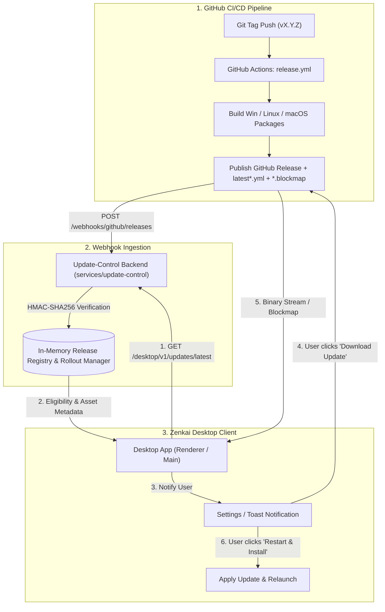

# Zenkai Desktop — Hybrid Update Infrastructure & Notify-First Delivery

This document specifies the architecture, operation, and security model of the **Zenkai Desktop Hybrid Update Infrastructure**.

---

## 1. Architectural Philosophy & Principles

Zenkai Desktop employs a **hybrid update infrastructure** designed around user autonomy, network efficiency, and production safety:

* **Notify-First Delivery (Strict User Consent):** The desktop application never silently downloads updates in the background (`autoDownload = false`), and never forces a restart or hijacks application quit (`autoInstallOnAppQuit = false`). Users are prompted with release notes and must explicitly choose to download and restart.
* **Hybrid Workload Distribution:**
  * **GitHub Actions & GitHub Releases (CDN):** Handles compilation, packaging, artifact signing, differential blockmaps (`.blockmap`), and high-bandwidth binary distribution.
  * **Update-Control Service:** A lightweight, stateless Node.js microservice that validates release webhooks, tracks rollout percentages, computes cohort eligibility, filters channels (`stable` vs `beta`), and provides emergency withdrawal controls.
* **Direct High-Bandwidth Binary Delivery:** Update binaries stream directly from GitHub's global CDN, never proxying through the update-control backend.
* **Privacy-Preserving Cohort Assignment:** Rollouts use a deterministic, non-reversible hash calculation (`sha256(installationId + ":" + releaseTag) % 100`). No personal identifiable information (PII), MAC addresses, or persistent hardware identifiers are ever collected or stored.
* **Zero-Downtime Fallback:** If the update-control service is temporarily unreachable, the desktop client automatically falls back to direct GitHub Releases API checks.

---

## 2. End-to-End System Architecture



---

## 3. Update-Control Backend Specification

The update-control service is located at `services/update-control/` with zero external database dependencies.

### 3.1 HTTP Endpoints

| Method | Path | Description | Access / Headers |
|---|---|---|---|
| `GET` | `/health` | Service liveness and release count | Public |
| `POST` | `/webhooks/github/releases` | Ingests GitHub release events | `X-Hub-Signature-256`, `X-GitHub-Event: release` |
| `GET` | `/desktop/v1/updates/latest` | Queries eligible update for client | `Cache-Control: public, max-age=300` |
| `GET` | `/desktop/v1/updates/:version` | Fetches details for a specific version | Public |

### 3.2 Webhook Security & Verification

Incoming webhooks are verified using constant-time HMAC-SHA256 comparison:
```typescript
const hmac = crypto.createHmac("sha256", secret);
hmac.update(rawBody);
const expectedSig = `sha256=${hmac.digest("hex")}`;
const valid = crypto.timingSafeEqual(Buffer.from(signature), Buffer.from(expectedSig));
```

Security controls enforced at the webhook layer:
1. **Repository Allowlisting:** Rejects events not originating from `johan-droid/Zenkai-Desktop-`.
2. **Draft Rejection:** Draft releases are discarded immediately.
3. **Delivery Deduplication:** Duplicate webhook delivery GUIDs (`X-GitHub-Delivery`) are tracked and ignored.
4. **Action Filtering:** Only `published`, `released`, and `prereleased` actions mutate release registry records.

### 3.3 Querying Latest Update (`GET /desktop/v1/updates/latest`)

**Query Parameters:**
* `installationId` *(string, required)*: Client's anonymous installation ID.
* `version` *(string, required)*: Current semver version (e.g. `0.0.1`).
* `platform` *(string, required)*: `win32`, `linux`, or `darwin`.
* `channel` *(string, optional)*: `stable` (default) or `beta`.

**Response Format:**
```json
{
  "updateAvailable": true,
  "version": "0.0.2",
  "channel": "stable",
  "releaseDate": "2026-11-15T18:00:00.000Z",
  "notes": "- Added hardware-accelerated video decoding\n- Performance enhancements",
  "mandatory": false,
  "assetUrl": "https://github.com/johan-droid/Zenkai-Desktop-/releases/download/v0.0.2/Zenkai-Desktop-v0.0.2-Linux-x64.AppImage"
}
```

---

## 4. Staged Rollout & Privacy Mechanics

### 4.1 Deterministic Cohort Calculation

To prevent "thundering herd" issues and catch edge-case crashes before they reach 100% of users, releases can be rolled out in staged percentages (e.g., 10% → 25% → 50% → 100%).

The client cohort is computed deterministically:
$$\text{bucket} = \text{sha256}(\text{installationId} + \text{":"} + \text{releaseTag}) \pmod{100}$$

* **Stable Cohort Per Release:** A given client either qualifies or does not qualify for a specific release, without changing state between requests.
* **Rotating Cohorts Across Releases:** Because the release tag is in the hash preimage, the 10% cohort for `v0.0.2` is a different randomized set of users than the 10% cohort for `v0.0.3`.
* **Zero PII:** `installationId` is a randomly generated UUID generated on first boot and stored in `settings.json`. It is never linked to IP addresses, MAC addresses, machine hostnames, or user accounts.

### 4.2 Emergency Withdrawal Runbook

If a critical issue or regression is discovered during a staged rollout:
1. The release can be withdrawn immediately using the service's release manager:
   ```typescript
   releaseService.withdrawRelease("0.0.2");
   ```
2. Once withdrawn, `evaluateUpdateEligibility` excludes `v0.0.2` from all update checks.
3. If an earlier stable version exists (e.g., `v0.0.1`), clients will be told they are on the latest allowed version, preventing any further clients from downloading the broken build.

---

## 5. Release Channels: Stable vs Beta

Users can configure their release channel in **Desktop Settings → Release Channel**:

| Channel | Eligibility | Tag Pattern Example |
|---|---|---|
| **Stable** (Default) | Only production-ready, non-prerelease tags | `v0.0.1`, `v1.0.0` |
| **Beta** (Opt-In) | Production releases **AND** pre-releases | `v0.0.2-beta.1`, `v0.0.2-rc.1` |

The update service enforces channel constraints: clients requesting `channel=stable` never receive releases marked `prerelease: true` or tags containing pre-release identifiers (`-beta`, `-alpha`, `-rc`).

---

## 6. Platform Packaging & Auto-Update Matrix

| Platform | Packaging Target | In-Place Delta Auto-Update | Delivery Behavior |
|---|---|---|---|
| **Windows x64** | NSIS (`.exe`) | Yes (`.blockmap`) | User clicks **Download Update**; electron-updater downloads differential blockmap; user clicks **Restart & Install**. |
| **Windows x64** | Portable (`.zip`) | No | Manual portable zip replacement. |
| **Linux x64** | AppImage (`.AppImage`) | Yes (`.AppImage`) | User clicks **Download Update**; electron-updater downloads binary in-place; user clicks **Restart & Install**. |
| **Linux x64** | Debian (`.deb`) | No (Requires root `dpkg/apt`) | User is prompted with release notes and provided a direct download button for the new `.deb` package. |
| **Linux x64** | RPM (`.rpm`) | No (Requires root `rpm/dnf`) | User is prompted with release notes and provided a direct download button for the new `.rpm` package. |
| **macOS** | DMG / Zip | When signed & notarized | Unsigned builds prompt user with direct download link per macOS Gatekeeper policy. |

---

## 7. Operational Setup & GitHub Webhook Runbook

### 7.1 GitHub Webhook Configuration
To connect GitHub Releases to the update-control backend:
1. Navigate to the GitHub repository: `https://github.com/johan-droid/Zenkai-Desktop-/settings/hooks`
2. Click **Add webhook**.
3. **Payload URL:** `https://<your-update-control-domain>/webhooks/github/releases`
4. **Content type:** `application/json`
5. **Secret:** Configure a cryptographically secure random string (e.g. `openssl rand -hex 32`).
6. **Which events would you like to trigger this webhook?**
   - Select **Let me select individual events**.
   - Check **Releases**.
   - Uncheck everything else.
7. Click **Add webhook**.

### 7.2 Service Environment Variables
On the server running `services/update-control/`:
```bash
PORT=3000
GITHUB_WEBHOOK_SECRET="<secret-configured-in-github>"
GITHUB_REPOSITORY="johan-droid/Zenkai-Desktop-"
```

Run the service:
```bash
node dist/server.js
```

